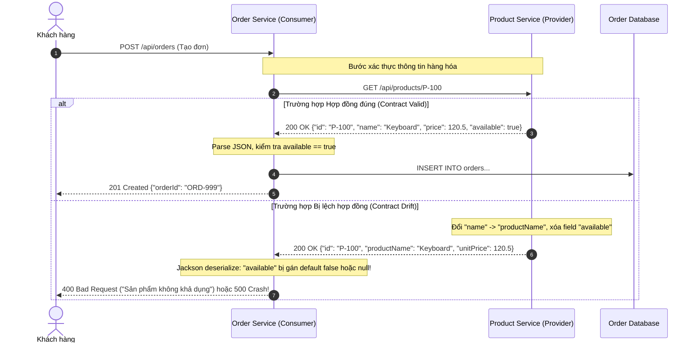

# Assignment 04: The Need for Contract Testing in Microservices

## 1. Sequence Diagram: Tương tác giữa Order Service và Product Service



---

## 2. Bảng phân tích Sự cố Phụ thuộc (Dependency Breakdown Table)

| Dependency | Consumer Expectation (Order Service kỳ vọng) | Nếu Provider đổi sai mà không báo trước | Unit Test có phát hiện không? Vì sao? | E2E Test có hạn chế gì nếu dùng để chặn lỗi này? |
| :--- | :--- | :--- | :--- | :--- |
| Product Service | • Endpoint: `GET /api/products/{id}`<br>• Response Status: `200 OK`<br>• Các trường bắt buộc: `id` (String), `name` (String), `price` (Number), `available` (Boolean: true). | • Đổi tên field `name` -> `productName`.<br>• Đổi `price` -> `unitPrice`.<br>• Xóa hẳn field `available`.<br>• Đổi `price` từ float `120.5` thành string `"120.50"`. | ❌ KHÔNG PHÁT HIỆN ĐƯỢC.<br>Vì Unit test của Order Service dùng Mockito để mock sẵn object trả về (`when(client.get()).thenReturn(...)`). Mock phản ánh kỳ vọng cũ của Dev, không phản ánh hiện thực của Provider. | • Chạy rất chậm: Mất hàng chục phút trong CI/CD.<br>• Môi trường phức tạp: Phải dựng cả Product Service, Database, Kafka.<br>• Flaky (Kém ổn định): Lỗi mạng chập chờn làm test fail oan.<br>• Phát hiện muộn: Thường chỉ chạy ở bước tích hợp cuối cùng. |
| Payment Service | • Endpoint: `POST /api/payments/charge`<br>• Header: `Idempotency-Key`<br>• Body: `{"orderId": "...", "amount": 120.5}`<br>• Status: `200 OK` kèm `{"transactionId": "TX-1", "status": "SUCCESS"}`. | • Đổi tên trường `transactionId` -> `txn_no`.<br>• Đổi status code từ `200` sang `202 Accepted` kèm webhook callback.<br>• Xóa bỏ việc đọc `Idempotency-Key`. | ❌ KHÔNG PHÁT HIỆN ĐƯỢC.<br>Mock client của Payment Service luôn trả về `SUCCESS` trong Unit test, hoàn toàn che giấu việc Provider đã đổi định dạng kết quả. | • Khó test các kịch bản ngoại lệ như Gateway bị timeout hoặc từ chối thẻ ngân hàng.<br>• Rủi ro trừ tiền thật hoặc phụ thuộc vào sandbox bên thứ ba thường xuyên bảo trì. |

---

## 3. Trả lời 3 Câu hỏi cốt lõi

### Q1. Vì sao Mock-based Unit Test không đủ để đảm bảo tính an toàn trong Microservices?
* Ảo tưởng an toàn (False Sense of Security): Trong Unit Test, ta dùng `Mockito.when(...)` hoặc `@MockBean` để giả lập hành vi của Service bên ngoài.
* Bản chất của Mock: Mock chỉ kiểm tra xem *“Code của tôi có xử lý đúng VỚI GIẢ THUYẾT mà tôi đưa ra hay không?”*. Nó hoàn toàn không chứng minh được là Service bên ngoài (Product Service thật) vẫn đang hoạt động đúng với giả thuyết đó!
* Khi Product Service thay đổi mã nguồn trên repository của họ, toàn bộ Unit Test của Order Service vẫn xanh 100%, tạo cảm giác yên tâm giả tạo trước khi đẩy lên Production và gây sự cố. Hiện tượng này gọi là Contract Drift (Lệch pha hợp đồng).

---

### Q2. Vì sao chỉ dùng End-to-End (E2E) Test là không đủ?
Nhiều đội ngũ cố gắng dựng môi trường Staging với đầy đủ tất cả Microservices để chạy Selenium / Cypress / Postman E2E test. Cách tiếp cận này gặp phải 4 bức tường:

1. Tốc độ cực chậm: Một bộ E2E test cho toàn bộ luồng có thể mất 30 phút đến vài giờ để chạy xong, làm tê liệt tốc độ release của CI/CD.
2. Khó xác định nguyên nhân (Root Cause Ambiguity): Khi một E2E test fail, rất khó biết lỗi do code của Order Service, do Product Service bị lỗi deploy, do DB hết bộ nhớ, hay đơn giản do đường truyền mạng nội bộ bị lag.
3. Chi phí môi trường khổng lồ: Trong hệ thống có 50–100 microservices, việc dựng và duy trì một môi trường Staging có dữ liệu đồng bộ và phiên bản tương thích giữa các service là một cơn ác mộng.
4. Bùng nổ tổ hợp (Combinatorial Explosion): Không thể viết đủ E2E test để phủ hết mọi nhánh logic và mã lỗi của từng cặp service giao tiếp với nhau.

---

### Q3. Contract Test đứng ở đâu trong Testing Pyramid / Microservice Strategy?

Trong kim tự tháp kiểm thử dành cho kiến trúc Microservices, Contract Testing nằm ở vị trí chiến lược: ở giữa Unit Test và E2E Test.

```
                ▲
               / \
              /E2E\             <-- Chậm nhất, đắt nhất, ít test nhất (Chỉ test luồng khói chính)
             /-----\
            /Contract\          <-- FAST & RELIABLE: Test tính tương thích API giữa các Team
           /  Tests   \             độc lập mà KHÔNG CẦN bật service phụ thuộc lên!
          /------------\
         /  Component   \       <-- Test tích hợp nội bộ trong từng service (kèm DB testcontainer)
        /----------------\
       /    Unit Tests    \     <-- Nhanh nhất, rẻ nhất, chạy nhiều nhất (Logic nội tại)
      /────────────────────\
```

* Contract Test lấp đầy khoảng trống chết người: 
  * Nó nhanh và nhẹ như Unit Test (chạy độc lập từng repo, không cần start service đối tác nhờ dùng Stub/Contract do Pact sinh ra).
  * Nhưng nó lại đem lại sự tin cậy tương thích giao tiếp ngang hàng với E2E Test.

---

## 4. Ví dụ cụ thể về một Breaking Change làm sập hệ thống

### Hợp đồng cũ (Version 1 - Đang chạy êm đẹp trên Production):
```json
// GET /api/products/P-100
{
  "id": "P-100",
  "name": "Bàn phím cơ Leopold",
  "price": 120.50,
  "available": true
}
```

### Thay đổi của Provider (Version 2 - Refactor nội bộ mà không báo trước):
```json
// GET /api/products/P-100
{
  "id": "P-100",
  "productName": "Bàn phím cơ Leopold",
  "unitPrice": 120.50
}
```

### Cơ chế sập lỗi (Root Cause Breakdown):
1. Lỗi 1 (Mất trường `available`): Code Order Service viết: `if (product.isAvailable() == false) throw new OutOfStockException();`. Do Jackson Mapper không thấy trường `available`, nó gán giá trị mặc định kiểu boolean nguyên thủy là `false` (hoặc `Boolean = null`). Toàn bộ đơn hàng mua sản phẩm này đều bị từ chối với lý do "Hết hàng"!
2. Lỗi 2 (Đổi tên `name` -> `productName`): Trường `name` trong đơn hàng bị lưu vào DB dưới dạng `null`, gây lỗi `NullPointerException` khi in hóa đơn hoặc gửi email thông báo.
