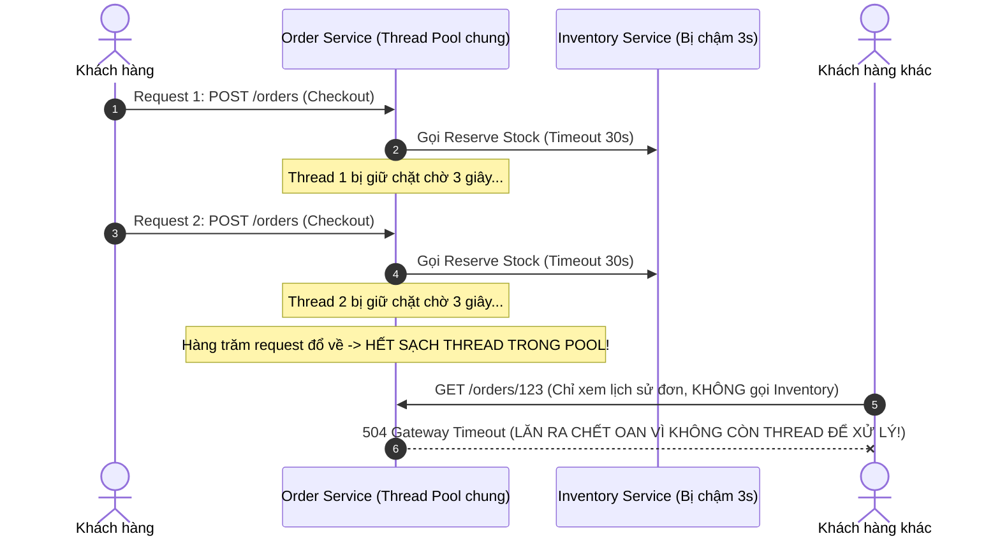
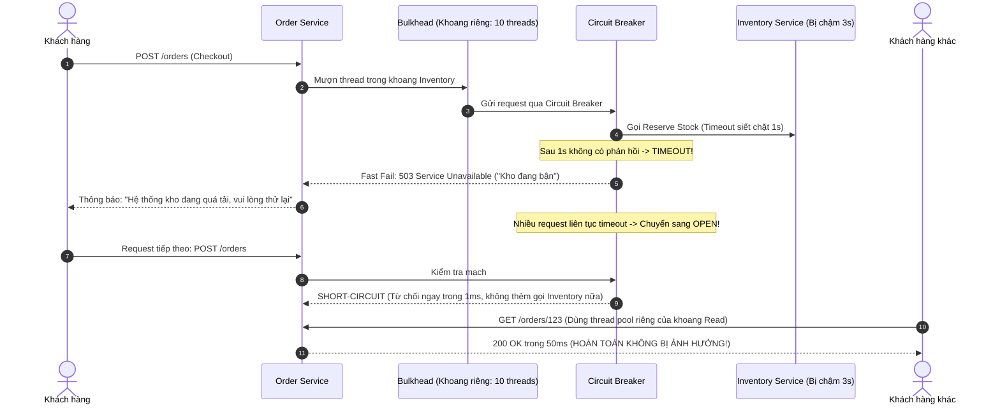

# Assignment 07: Chaos Engineering in Practice & Resilience Architecture

Tài liệu này trình bày chi tiết việc thiết kế 2 bài kiểm thử hỗn loạn thực chiến (Experiment A: Latency Injection và Experiment B: Partial 500 Failure), phân tích luồng lỗi dây chuyền và giải pháp kiến trúc phục hồi (Resilience Patterns) cho Order Service.

---

## 1. Bảng Kế hoạch So sánh 2 Chaos Experiments

| Tiêu chí so sánh | Experiment A: Latency Injection (Tiêm Độ trễ) | Experiment B: Partial HTTP 500 (Tiêm Lỗi 5xx) |
| :--- | :--- | :--- |
| 1. Fault (Hành vi tiêm lỗi) | Dùng Toxiproxy hoặc Chaos Mesh inject thêm 3,000ms (3 giây) độ trễ vào toàn bộ request gửi tới Inventory Service. | Dùng WireMock hoặc Envoy/Istio Fault Injection ép Payment Service trả về mã lỗi HTTP 500 cho 20% lượng request ngẫu nhiên trong vòng 5 phút. |
| 2. Hypothesis (Giả thuyết) | *"Khi Inventory bị chậm 3s, cơ chế Timeout (1s) và Circuit Breaker của Order Service sẽ ngắt mạch (OPEN), chuyển sang trả lỗi nhanh hoặc Fallback. Thread pool của Order Service không bị cạn kiệt, các API khác như `GET /orders` vẫn phản hồi bình thường $< 200\text{ms}$."* | *"Khi Payment Service lỗi 500 ở 20% request, Order Service chỉ retry tối đa 2 lần kèm Exponential Backoff + Idempotency Key. Không xảy ra hiện tượng trừ tiền 2 lần, các đơn hàng lỗi được đưa vào Dead Letter Queue (DLQ) để hoàn tác, 80% đơn còn lại thanh toán bình thường."* |
| 3. Blast Radius (Phạm vi) | Môi trường Staging, áp dụng cho endpoint nội bộ `/api/inventory/reserve` trong 3 phút. | Môi trường Staging, giới hạn trong 20% request của Payment trong 5 phút. |
| 4. Expected Behavior (Hành vi mong đợi) | • Checkout API fail-fast sau 1 giây (do Timeout). • Sau 10 request timeout liên tiếp, Circuit Breaker chuyển sang `OPEN`, từ chối ngay lập tức trong 2ms. • API `GET /orders/{id}` hoàn toàn không bị ảnh hưởng. | • 80% checkout thành công mượt mà. • 20% checkout nhận mã lỗi rõ ràng `PAYMENT_FAILED_PLEASE_RETRY`. • Khách hàng không bao giờ bị trừ tiền mà không nhận được đơn. |
| 5. Timeout / Retry / Circuit Breaker Behavior | • Timeout: Ngắt kết nối sau 1,000ms (Không cho phép treo 30s). • Retry: KHÔNG RETRY khi lỗi là Timeout do downstream chậm (để tránh làm Inventory nghẽn thêm). • Circuit Breaker: Đếm tỷ lệ timeout $> 50\%$ trong 10s -> Bật `OPEN`. | • Timeout: 2,000ms. • Retry: Retry tối đa 2 lần, mỗi lần cách nhau 500ms + random jitter, bắt buộc truyền header `Idempotency-Key`. • Circuit Breaker: Tỷ lệ lỗi 20% chưa chạm ngưỡng ngắt mạch (ngưỡng ngắt thường cấu hình 50%). |
| 6. Abort Condition (Dừng khẩn cấp) |  Dừng ngay nếu Thread Pool của Order Service chạm trần 100% active threads.  Dừng ngay nếu API `GET /orders` bị latency $> 1\text{s}$. |  Dừng ngay nếu phát hiện có bất kỳ trường hợp nào bị Duplicate Charge (Trừ tiền 2 lần).  Dừng nếu tổng tỷ lệ lỗi của toàn hệ thống $> 30\%$. |
| 7. Observability & Metrics | • `resilience4j_circuitbreaker_state{state="open"}` • `tomcat_threads_busy` • `http_server_requests_seconds{uri="/api/orders/{id}"}` | • `payment_duplicate_transaction_count` • `http_client_retries_total` • `dead_letter_queue_messages_count` |
| 8. Rollback Procedure | Gỡ bỏ cấu hình latency trên Toxiproxy/Chaos Mesh. Kiểm tra Circuit Breaker chuyển từ `OPEN` -> `HALF-OPEN` -> `CLOSED`. | Tắt filter inject lỗi HTTP 500 trên proxy. Chạy job reconciliation quét DB kiểm tra toàn vẹn tài chính. |

---

## 2. Sequence Diagram: So sánh Kiến trúc Sập dây chuyền vs Kiến trúc Kháng lỗi

### Kịch bản Thảm họa: Khi KHÔNG CÓ Resilience Patterns (Cascading Failure)

### Kịch bản An toàn: Khi ÁP DỤNG Resilience Patterns (Bulkhead + Circuit Breaker + Timeout)

---

## 3. Phân biệt Sâu sắc: Retry vs Circuit Breaker

| Đặc điểm | Cơ chế Retry (Thử lại) | Cơ chế Circuit Breaker (Cầu dao ngắt mạch) |
| :--- | :--- | :--- |
| Bản chất hành động | Gửi thêm request tới hệ thống đích với hy vọng lần sau sẽ thành công. | Chặn đứng request, không cho phép gửi bất kỳ request nào tới hệ thống đích. |
| Phù hợp khi nào? | Khi lỗi mang tính chất thoáng qua (Transient Network Blip), ví dụ: rớt gói tin mạng trong vài phần trăm giây. | Khi lỗi mang tính chất kéo dài hoặc quá tải hệ thống (System Overload / Outage), ví dụ DB đối tác bị chết hoặc chậm hàng loạt. |
| Rủi ro lớn nhất | Cực kỳ nguy hiểm nếu dùng sai: Khi downstream đang ngạt thở, Retry liên tục sẽ tạo ra Retry Storm (Cơn bão thử lại), làm tăng gấp 3 - 5 lần lượng traffic đổ vào hệ thống đang chết, biến bạn thành kẻ tự tấn công từ chối dịch vụ (DDoS) chính mình! | Có thể từ chối một vài request người dùng trong thời gian mạch đang `OPEN`, nhưng đổi lại bảo vệ toàn bộ hệ thống sống sót. |

---

## 4. Xử lý An toàn cho Giao dịch Tài chính Thất bại (Financial Transactions)

Khi gọi cổng thanh toán bị lỗi hoặc timeout giữa chừng, tuyệt đối không được chỉ dựa vào auto-retry mù quáng. Cần thiết kế 3 lớp bảo vệ:

1. Bắt buộc dùng Khóa lũy đẳng (Idempotency Key):
   * Mỗi lệnh gọi trừ tiền phải gửi kèm UUID của đơn hàng: `Idempotency-Key: ORD-999-PAY`. Cổng thanh toán chỉ thực thi giao dịch đúng một lần duy nhất với key này.
2. Hàng đợi Thư chết (Dead Letter Queue - DLQ):
   * Nếu sau 2 lần retry mà vẫn timeout hoặc trả về lỗi không xác định (`UNKNOWN`), message đơn hàng được đưa vào DLQ kèm trạng thái `PAYMENT_PENDING_CONFIRMATION`.
3. Tiến trình Đối soát Định kỳ (Reconciliation Background Job):
   * Một Cron Job chạy mỗi 5 phút quét các đơn hàng trong DLQ, gọi API truy vấn trạng thái giao dịch (`GET /api/payments/status?ref=ORD-999-PAY`) để đối soát với ngân hàng:
     * Nếu tiền đã trừ: Tự động chuyển đơn hàng thành `PAID`.
     * Nếu tiền chưa trừ: Đánh dấu đơn hàng là `FAILED` và hoàn trả kho.
