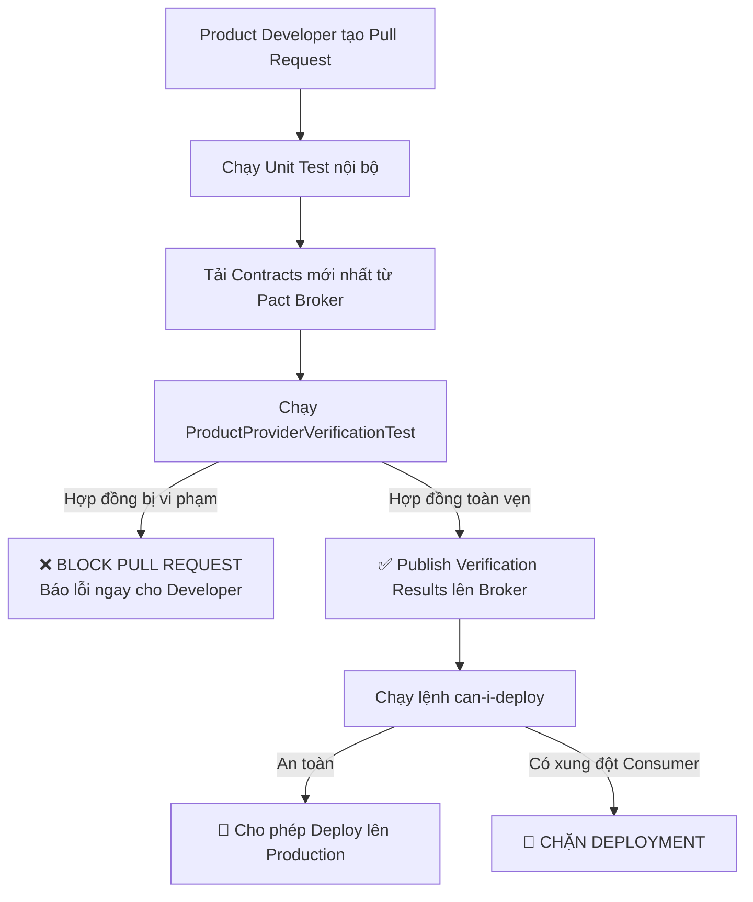

# Kế hoạch Xác minh Nhà cung cấp (Provider Verification Plan)

Tài liệu này hướng dẫn cách thiết lập kiểm thử tự động phía **Product Service (Provider)** để đảm bảo mọi thay đổi mã nguồn không vi phạm các bản hợp đồng đã cam kết với các Consumers.

---

## 1. Triển khai Provider Test trong Java (Spring Boot)

Product Service sử dụng thư viện `pact-jvm-provider-spring` hoặc `pact-jvm-provider-junit5` để tự động kiểm tra code Controller thật đối chiếu với các bản hợp đồng lưu trên Pact Broker.

```java
package com.example.productservice.contract;

import au.com.dius.pact.provider.junit5.HttpTestTarget;
import au.com.dius.pact.provider.junit5.PactVerificationContext;
import au.com.dius.pact.provider.junit5.PactVerificationInvocationContextProvider;
import au.com.dius.pact.provider.junitsupport.Provider;
import au.com.dius.pact.provider.junitsupport.State;
import au.com.dius.pact.provider.junitsupport.loader.PactBroker;
import com.example.productservice.domain.Product;
import com.example.productservice.repository.ProductRepository;
import org.junit.jupiter.api.BeforeEach;
import org.junit.jupiter.api.TestTemplate;
import org.junit.jupiter.api.extension.ExtendWith;
import org.springframework.boot.test.context.SpringBootTest;
import org.springframework.boot.test.mock.mockito.MockBean;
import org.springframework.boot.test.web.server.LocalServerPort;

import java.math.BigDecimal;
import java.util.Optional;

import static org.mockito.Mockito.when;

@SpringBootTest(webEnvironment = SpringBootTest.WebEnvironment.RANDOM_PORT)
@Provider("ProductService")
@PactBroker(url = "${PACT_BROKER_BASE_URL:http://localhost:9292}")
public class ProductProviderVerificationTest {

    @LocalServerPort
    private int port;

    @MockBean
    private ProductRepository productRepository;

    @BeforeEach
    void setup(PactVerificationContext context) {
        context.setTarget(new HttpTestTarget("localhost", port));
    }

    @TestTemplate
    @ExtendWith(PactVerificationInvocationContextProvider.class)
    void pactVerificationTestTemplate(PactVerificationContext context) {
        context.verifyInteraction();
    }

    // 2. Định nghĩa Provider States tương ứng với file Contract
    @State("product with ID P-100 exists and is in stock")
    public void toProductExistsState() {
        Product mockProduct = new Product("P-100", "Mechanical Keyboard", new BigDecimal("120.50"), true);
        when(productRepository.findById("P-100")).thenReturn(Optional.of(mockProduct));
    }

    @State("product with ID P-999 does not exist")
    public void toProductDoesNotExistState() {
        when(productRepository.findById("P-999")).thenReturn(Optional.empty());
    }
}
```

---

## 2. Quy trình tích hợp CI/CD (GitHub Actions / GitLab CI)



### Câu lệnh kiểm tra triển khai an toàn (`can-i-deploy`):
Trước khi kích hoạt lệnh deploy lên Production, pipeline chạy script kiểm tra chéo:

```bash
pact-broker can-i-deploy \
  --pacticipant ProductService \
  --version ${GIT_COMMIT_HASH} \
  --to-environment production \
  --broker-base-url https://pact-broker.company.internal \
  --broker-token ${PACT_BROKER_TOKEN}
```

* Nếu `can-i-deploy` trả về mã thoát `0` (Success): Cho phép kích hoạt ArgoCD / Helm deploy.
* Nếu trả về mã thoát khác `0`: Dừng pipeline ngay lập tức.
