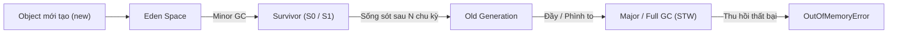

# 01. JVM Performance Notes

## 1. Giải thích các khái niệm cốt lõi

* **Heap Memory:** Vùng nhớ chứa phần lớn các Java Object được tạo ra bằng từ khóa `new`. Được quản lý tự động bởi bộ thu gom rác (Garbage Collector). Chia thành Young Generation (Eden, Survivor) và Old/Tenured Generation.
* **Stack Memory:** Vùng nhớ cấp phát riêng cho từng Thread. Dùng để lưu trữ Call Stack (các frame hàm) và biến nguyên thủy (primitive), biến tham chiếu (reference) cục bộ trong hàm. Khi hàm kết thúc, stack frame tự giải phóng, không cần GC.
* **GC Pause (Stop-The-World):** Khoảng thời gian JVM tạm dừng tất cả các luồng ứng dụng (application threads) để GC thực hiện dọn dẹp bộ nhớ an toàn. GC Pause trực tiếp gây ra độ trễ (latency/p99) cho API.
* **Allocation Rate:** Tốc độ ứng dụng cấp phát object mới vào Heap (thường tính bằng MB/s). Nếu allocation rate quá cao, Young Gen nhanh đầy, dẫn đến GC phải chạy thường xuyên hơn.

---

## 2. Sơ đồ Heap & GC Lifecycle Flow

---

## 3. So sánh G1 GC vs ZGC

| Tiêu chí | G1 GC (Garbage-First) | ZGC (Z Garbage Collector) |
| :--- | :--- | :--- |
| **Mục tiêu chính** | Cân bằng giữa throughput (thông lượng) và pause-time mục tiêu (`-XX:MaxGCPauseMillis`). | Tối ưu độ trễ cực thấp (Ultra-low latency), GC pause cam kết dưới 1ms. |
| **Cơ chế vùng nhớ** | Chia heap thành các Region cố định (1MB–32MB), ưu tiên dọn vùng chứa nhiều rác nhất trước. | Chia Region động (Small, Medium, Large), dùng Colored Pointers và Load Barriers để dọn dẹp concurrent (đồng thời). |
| **Trade-off** | Pause time có thể dao động từ vài chục đến hàng trăm ms khi heap lớn hoặc chịu tải cao. | Tốn thêm khoảng 5–15% CPU và throughput có thể giảm nhẹ do chi phí load barriers. |
| **Kích thước Heap phù hợp** | Tốt cho heap từ 4GB đến vài chục GB. | Rất mạnh cho heap lớn (từ 16GB lên tới hàng Terabyte). |

> **Tại sao cần benchmark thay vì đoán?**
> Không có GC nào "tốt nhất cho mọi bài toán". Việc chọn GC phụ thuộc vào workload cụ thể (read-heavy hay write-heavy, tuổi thọ object dài hay ngắn, SLA ưu tiên p99 latency hay total throughput). Đổi từ G1 sang ZGC mà không đo đạc thực tế có thể làm tăng chi phí CPU hoặc giảm RPS tổng thể.

---

## 4. Phân tích tình huống (Scenario)

### Hiện tượng:
* Payroll API có p99 tăng vọt từ 400ms lên 8s.
* Application CPU chỉ khoảng 45%.
* Heap usage có biểu đồ răng cưa (saw-tooth) dốc liên tục.
* Full GC xuất hiện nhiều lần trong giờ cao điểm.

### Giả thuyết ban đầu (Hypothesis):
1. **Allocation rate quá lớn:** API gom dữ liệu chi tiết quá cồng kềnh (ví dụ export hoặc load hàng chục ngàn dòng lương cùng lúc), đẩy nhiều object dung lượng lớn thẳng lên Old Gen làm kích hoạt Full GC liên tục.
2. **GC Pause gây nghẽn:** CPU 45% cho thấy server không bị nghẽn CPU tính toán, mà các thread đang bị "đóng băng" bởi các đợt Stop-The-World kéo dài của Full GC.

### Metric / Log cần thu thập thêm:
* **GC Log (`-Xlog:gc*`):** Kiểm tra tần suất và thời gian dừng của GC (GC pause duration, phase nào gây dừng lâu).
* **Heap after GC:** Quan sát dung lượng Heap sau mỗi lần Full GC. Nếu sau Full GC mà Heap vẫn không hạ xuống $\rightarrow$ nguy cơ Memory Leak. Nếu sau GC heap hạ sâu rồi lại tăng vọt $\rightarrow$ Allocation pressure (tạo rác ngắn hạn quá nhanh).
* **GC Allocation Rate:** Đo lượng memory cấp phát mỗi giây để xác định API nào đang "xả rác".
* **Thread Dumps:** Kiểm tra trạng thái thread lúc p99 tăng để xem có thread nào đang chờ lock hoặc DB I/O không.

> **Lưu ý:** Tuyệt đối không kết luận hệ thống bị thiếu RAM hay GC bị lỗi chỉ qua một biểu đồ Heap. Cần đối chiếu đồng thời: Heap before/after GC, GC Pause Time và Thread State.

---

## 5. Bảng Symptom → Possible Cause → Evidence

| Symptom | Possible Cause | Evidence cần kiểm tra |
| :--- | :--- | :--- |
| **Heap tăng dần, không giảm sau Full GC** | Memory Leak (object bị giữ reference ở static map, cache, unclosed stream) | Heap Dump: Dominator tree, retained heap của các class nghi vấn. |
| **Heap hình răng cưa dốc đứng, Full GC liên tục** | Allocation pressure (tạo quá nhiều object tạm thời trong request) | GC Log: Allocation rate (MB/s), Eden promotion rate sang Old Gen. |
| **p99 cao, CPU thấp (< 40%)** | GC Pause kéo dài (STW) hoặc Thread bị nghẽn I/O / DB connection | GC Pause metrics (`jvm.gc.pause`), Thread Dump (threads ở trạng thái `WAITING`, `TIMED_WAITING`). |
| **CPU chạm 100%, GC chạy không ngừng** | Cạn kiệt Heap, JVM liên tục cố dọn rác vô vọng (GC Thrashing) | GC CPU usage, Heap usage > 95% liên tục sau Full GC. |
