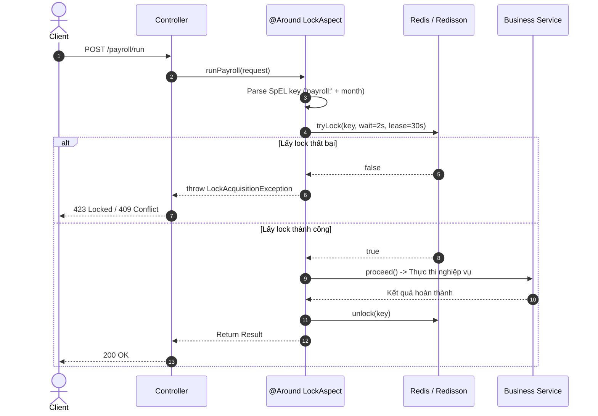
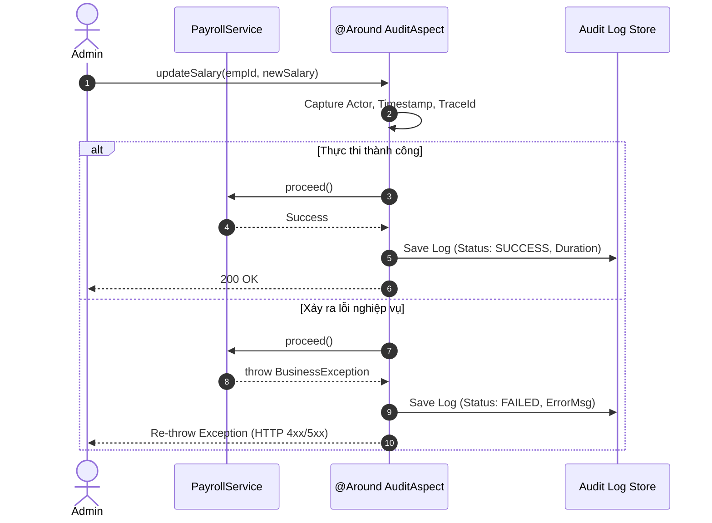

# 03. Spring AOP Design: Custom Aspects & Distributed Lock

## 1. Thiết kế 2 Custom Annotations

### A. `@DistributedLock`
* **Mục đích:** Đảm bảo chỉ một tiến trình được thực thi business method tại một thời điểm cho một tài nguyên cụ thể (phân tán qua Redis/Redisson).
* **Pointcut:** Áp dụng trên method tầng Service thực thi tác vụ quan trọng (ví dụ: `runPayroll()`).
* **Cơ chế `@Around` Advice:**
  1. Parse SpEL (Spring Expression Language) từ tham số method để sinh `lockKey` cụ thể (ví dụ: `payroll:tenant_123:2026-10`).
  2. Thử lấy lock (ví dụ Redisson `tryLock(waitTime = 2s, leaseTime = 30s)`).
  3. **Nếu không lấy được lock:** Ném ra `LockAcquisitionException` $\rightarrow$ Tầng Controller bắt lỗi và trả về HTTP status `423 Locked` hoặc `409 Conflict` (báo client tác vụ đang được xử lý).
  4. **Nếu lấy được lock:** Gọi `joinPoint.proceed()` để thực thi method gốc.
  5. **Trong khối `finally`:** Kiểm tra và giải phóng lock nếu thread hiện tại đang giữ lock (`isHeldByCurrentThread()`).

### B. `@AuditAction`
* **Mục đích:** Ghi vết tự động (Metadata, kết quả, thời gian thực thi) của các hành động nhạy cảm mà không làm bẩn code nghiệp vụ.
* **Pointcut:** Áp dụng trên method thay đổi trạng thái (Create, Update, Delete) như `updateSalary()`.
* **Cơ chế `@Around` Advice:**
  1. Ghi nhận thời điểm bắt đầu (`startTime`), lấy `userId`/`tenantId` từ Security Context, lấy `traceId` từ MDC.
  2. Gọi `joinPoint.proceed()`.
  3. **Nếu thành công:** Ghi audit log với trạng thái `SUCCESS`, lưu lại kết quả trả về và thời gian xử lý (`duration`).
  4. **Nếu có Exception:** Bắt Exception, ghi audit log với trạng thái `FAILED`, ghi nhận mã lỗi và `exceptionMessage`, sau đó **bắt buộc re-throw exception** (không được nuốt lỗi để transaction rollback bình thường).

---

## 2. Sequence Diagrams

### Sequence Diagram: `@DistributedLock`

---

### Sequence Diagram: `@AuditAction`

---

## 3. Các trường dữ liệu cần có trong Audit Log

* `traceId` / `correlationId`: Để truy vết xuyên suốt qua các Microservices.
* `action`: Tên hành động (ví dụ: `UPDATE_SALARY`, `RUN_PAYROLL`).
* `actor`: Định danh người thực hiện (User ID / Username / Client ID).
* `tenantId`: Định danh tổ chức (Multi-tenant).
* `targetResource`: Đối tượng bị tác động (ví dụ: `Employee:E-100`).
* `status`: `SUCCESS` hoặc `FAILED`.
* `executionTimeMs`: Thời gian xử lý của method.
* `errorMessage`: Chi tiết lỗi nếu status là `FAILED`.

---

## 4. Danh sách rủi ro khi lạm dụng AOP

1. **Che giấu luồng thực thi (Invisible Flow):** Đặt quá nhiều logic trong Aspect khiến người đọc code không thấy được luồng chạy thực tế, cực kỳ khó debug.
2. **Bỏ qua Proxy khi gọi nội bộ (Self-invocation Bypass):** Nếu method A gọi method B trong cùng một class (`this.methodB()`), Spring AOP Proxy sẽ bị bỏ qua, dẫn đến Annotation trên method B không chạy.
3. **Nuốt Exception trái phép:** Nếu Aspect bắt lỗi mà không re-throw, Spring `@Transactional` sẽ không biết để rollback dữ liệu, gây mất tính toàn vẹn.
4. **Xung đột thứ tự Aspect (Aspect Precedence):** Khi một method dùng cả `@Transactional`, `@DistributedLock`, `@AuditAction`, nếu thứ tự chạy không được quy định rõ (thiếu `@Order`), Transaction có thể commit sau khi Lock đã bị nhả ra ngoài!
5. **CẤM nhét Core Business Rules vào AOP:** AOP chỉ dành cho Infrastructure/Cross-cutting concerns (Lock, Log, Metric). Không được nhét công thức tính tiền hay workflow nghiệp vụ vào Aspect.
