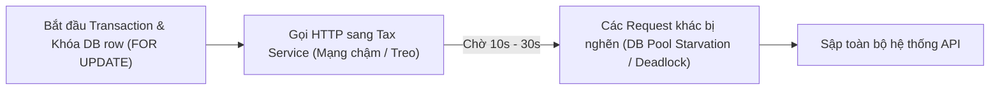

# 04. Data Locking Strategy: Optimistic vs Pessimistic

## 1. Hiện tượng Lost Update trong kịch bản HR sửa lương

### Kịch bản thực tế:
* Lương hiện tại của nhân viên E-100 là 20.000.000 VNĐ.
* 10:00: Manager A mở form xem lương $\rightarrow$ đọc được 20M.
* 10:01: Manager B mở form xem lương $\rightarrow$ đọc được 20M.
* 10:02: Manager A chỉnh sửa thành 25M và bấm Lưu $\rightarrow$ DB cập nhật thành 25M.
* 10:03: Manager B chỉnh sửa thành 22M và bấm Lưu $\rightarrow$ DB cập nhật thành 22M.

### Hậu quả nếu không có cơ chế khóa:
* Bản ghi của Manager B ghi đè hoàn toàn thay đổi của Manager A (Last-Write-Wins).
* Toàn bộ thay đổi của Manager A bị mất vĩnh viễn (Lost Update) mà không một ai (kể cả Manager A và B) nhận được bất kỳ cảnh báo nào.

---

## 2. Thiết kế giải pháp với Optimistic Locking (`@Version`)

Bổ sung trường version vào Entity:

```java
@Entity
@Table(name = "employee_salary")
public class EmployeeSalary {
    @Id
    private Long id;

    private Long employeeId;
    private BigDecimal baseSalary;

    @Version
    private Long version; // Hibernate tự động quản lý trường này
}
```

### Cơ chế hoạt động:
1. Khi Manager A và B đọc dữ liệu, cả hai đều nhận được `version = 1`.
2. Khi Manager A lưu trước, Hibernate sinh câu lệnh SQL:
   ```sql
   UPDATE employee_salary 
   SET base_salary = 25000000, version = 2 
   WHERE id = 100 AND version = 1;
   ```
   $\rightarrow$ Update thành công 1 dòng, version tăng lên `2`.
3. Khi Manager B lưu sau (vẫn mang theo `version = 1` lúc đọc):
   ```sql
   UPDATE employee_salary 
   SET base_salary = 22000000, version = 2 
   WHERE id = 100 AND version = 1;
   ```
   $\rightarrow$ Câu lệnh update 0 dòng (vì version trên DB lúc này đã là `2`). Hibernate phát hiện không có dòng nào được cập nhật và lập tức ném lỗi:
   `OptimisticLockException` (hoặc `ObjectOptimisticLockingFailureException` trong Spring).

---

## 3. Xử lý Exception và Trải nghiệm người dùng (UX) khi Conflict

* **Xử lý tại Backend:**
  * Bắt `OptimisticLockException` tại Global Exception Handler (`@RestControllerAdvice`).
  * Trả về HTTP status **`409 Conflict`** kèm thông tin phiên bản mới nhất:
    ```json
    {
      "code": "DATA_CONFLICT",
      "message": "Dữ liệu lương của nhân viên này vừa được cập nhật bởi một người khác.",
      "currentSalary": 25000000
    }
    ```
* **Trải nghiệm trên UI/Frontend:**
  * **Không âm thầm ghi đè:** Hiển thị thông báo rõ ràng cho Manager B.
  * **Cung cấp màn hình so sánh (Diff view):** Hiển thị giá trị ban đầu (20M), giá trị người khác vừa đổi (25M), và giá trị Manager B định nhập (22M).
  * **Hành động gợi ý:** Cho phép Manager B bấm "Tải lại dữ liệu mới nhất" hoặc xác nhận xem có muốn tiếp tục sửa đổi dựa trên con số mới hay không.

---

## 4. Khi nào nên dùng Pessimistic Lock?

* **Đặc điểm:** Dùng câu lệnh `SELECT ... FOR UPDATE` để khóa chặt dòng dữ liệu ngay từ lúc đọc, bắt mọi transaction khác phải xếp hàng chờ.
* **Chỉ nên dùng khi:**
  * Tranh chấp tài nguyên diễn ra cực kỳ khốc liệt trong thời gian ngắn (ví dụ: mua vé xem ca nhạc ghế cuối cùng, trừ tồn kho Flash Sale).
  * Chi phí rollback và retry quá tốn kém hoặc không được phép thất bại.
  * **Điều kiện tiên quyết:** Transaction phải cực kỳ ngắn (chỉ vài chục mili-giây).
* **Tuyệt đối KHÔNG dùng Pessimistic Lock khi:**
  * Thao tác có sự tương tác của con người (HR mở form ra xem và suy nghĩ 5–10 phút mới bấm nút). Giữ lock DB trong thời gian này sẽ bóp nghẹt toàn bộ connection pool của hệ thống.

---

## 5. Vì sao cấm giữ Pessimistic Lock khi gọi External Service (Tax Service)?



* **Lý do cốt lõi:**
  1. **Cạn kiệt DB Connection Pool (Connection Starvation):** Cuộc gọi mạng sang dịch vụ thứ ba (Third-party HTTP call) có độ trễ không thể đoán trước (vài giây đến vài chục giây). Trong suốt thời gian đó, DB connection bị "giam lỏng", khiến các request khác không thể lấy được connection từ pool.
  2. **Nguy cơ Deadlock:** Khi nhiều transaction cùng giữ lock dòng này và chờ gọi network để lock tiếp dòng khác, hệ quả là toàn bộ DB bị treo cứng.
* **Nguyên tắc vàng:**
  > Chỉ thực hiện các cuộc gọi bên ngoài (External I/O) TRƯỚC HOẶC SAU transaction cơ sở dữ liệu. Giữ transaction và lock càng ngắn càng tốt.
