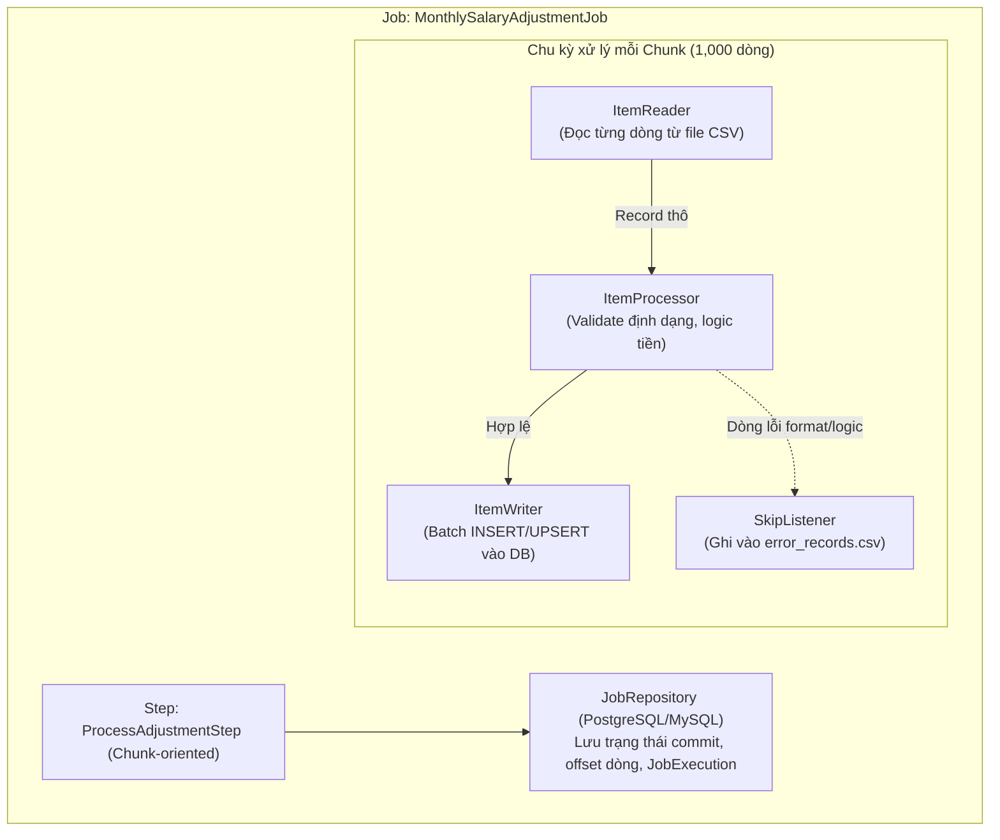

# 06. Spring Batch Architecture: Xử lý 3 triệu bản ghi Salary Adjustment

## 1. Sơ đồ Kiến trúc luồng Batch Job



---

## 2. Chunk Size đề xuất & Lý do lựa chọn

* **Chunk Size đề xuất:** **`1,000` bản ghi/chunk**.
* **Phân tích trade-off:**
  * **Nếu chunk quá nhỏ (ví dụ 10–50 dòng):** Quá nhiều transaction commit liên tục, chi phí mở đóng transaction và round-trip network tới DB quá lớn làm giảm throughput nghiêm trọng.
  * **Nếu chunk quá lớn (ví dụ 50,000 dòng):** Tốn nhiều RAM để gom object trên Heap, thời gian lock bảng lâu, và nếu dòng thứ 49,999 bị lỗi thì phải rollback cả 50,000 dòng rất lãng phí.
  * **Mức 1,000 dòng:** Đạt điểm cân bằng tối ưu giữa Heap memory (chỉ chiếm vài chục MB RAM tạm thời) và hiệu năng JDBC Batching (`rewriteBatchedStatements=true`). 3 triệu dòng sẽ được hoàn thành trong 3,000 chunk commits.

---

## 3. Chính sách Skip & Retry (Skip/Retry Policy)

### A. Skip Policy (Bỏ qua dòng lỗi)
* **Các lỗi được phép Skip:** Lỗi format dữ liệu (`FlatFileParseException`), lỗi logic dữ liệu nghiệp vụ (`IllegalArgumentException` như số tiền âm, sai định dạng ngày).
* **Ngưỡng giới hạn (Skip Limit):** Cho phép skip tối đa **`5,000` dòng**. Nếu số dòng lỗi vượt quá ngưỡng này, toàn bộ Job sẽ dừng lại ngay lập tức (`FAILED`) để tránh trường hợp file CSV bị hỏng cấu trúc toàn bộ.
* **Xử lý dòng lỗi:** Sử dụng `ItemSkipListener`:
  * Khi một dòng bị skip, listener bắt lấy nội dung dòng gốc, số dòng và nguyên nhân lỗi, sau đó ghi trực tiếp vào file `rejected_adjustments_yyyyMM.csv` để gửi lại cho phòng HR chỉnh sửa.

### B. Retry Policy
* Chỉ áp dụng retry cho các lỗi hạ tầng tạm thời (Transient Errors) như nghẽn mạng DB (`DeadlockLoserDataAccessException`, `CannotAcquireLockException`).
* Cấu hình retry tối đa 3 lần với Exponential Backoff (1s $\rightarrow$ 2s $\rightarrow$ 4s). Tuyệt đối **không retry** lỗi cú pháp dữ liệu.

---

## 4. Chiến lược đảm bảo tính lũy kế an toàn (Idempotency Strategy)

Để tránh nguy cơ cộng tiền 2 lần khi HR vô tình upload cùng 1 file 2 lần hoặc job bị restart lại:

1. **Composite Unique Key tại tầng Database:**
   ```sql
   ALTER TABLE salary_adjustment 
   ADD CONSTRAINT uq_salary_adj 
   UNIQUE (tenant_id, employee_id, effective_date, adjustment_type, source_batch_id);
   ```
2. **Cơ chế Ghi (ItemWriter):**
   * Sử dụng câu lệnh **`UPSERT`** (ví dụ PostgreSQL `INSERT ... ON CONFLICT (uq_salary_adj) DO NOTHING` hoặc `DO UPDATE`).
   * Không dùng `INSERT` thuần túy để tránh dính duplicate key crash job.

---

## 5. Quy trình phục hồi khi gặp sự cố (Restart & Recovery Flow)

1. **Lưu trạng thái tự động:** Nhờ `JobRepository` lưu trữ `ExecutionContext`, Spring Batch tự động đánh dấu offset dòng cuối cùng đã commit thành công trong bảng `BATCH_STEP_EXECUTION_CONTEXT`.
2. **Khi gặp sự cố (ví dụ mất điện lúc xử lý đến dòng 1,500,000):**
   * Các dòng từ 1 đến 1,500,000 đã nằm trọn vẹn trong các chunk commit trước đó $\rightarrow$ an toàn.
   * Chunk đang dở dang (ví dụ từ 1,500,001 đến 1,501,000) sẽ tự động rollback theo cơ chế Transaction của Spring.
3. **Khi kích hoạt Restart (`JobLauncher.run` với cùng JobParameters):**
   * Spring Batch đọc metadata từ `JobRepository`, phát hiện step bị `FAILED`.
   * `FlatFileItemReader` tự động nhảy cóc (jump/seek) qua đúng 1,500,000 dòng đầu và bắt đầu đọc tiếp từ dòng 1,500,001.
   * Hệ thống tiếp tục chạy mà không xử lý lại dữ liệu cũ, không gây trùng lặp và không tốn thời gian chạy lại từ đầu.
