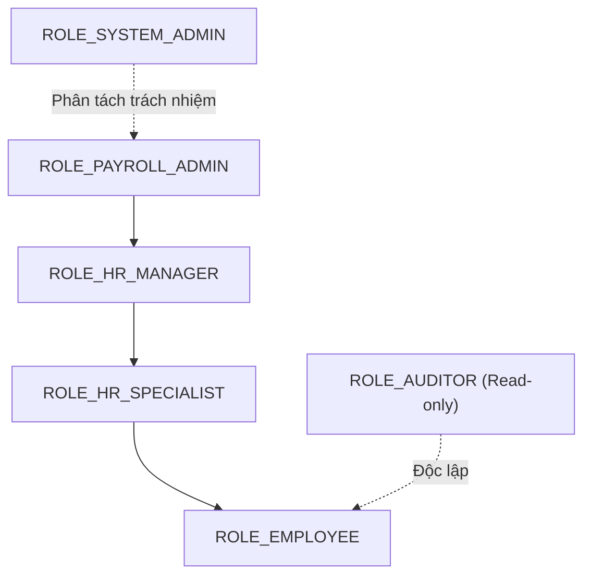

# 01. RBAC Design: Role-Based Access Control cho HR/Payroll SaaS

## 1. Thiết kế Danh mục Roles & Permissions

### Danh mục Permissions (Đặc quyền nguyên tử)
* `employee:read:self` / `employee:update:self`
* `employee:read:dept` / `employee:update:dept`
* `employee:read:all` / `employee:update:all`
* `salary:read` / `salary:update`
* `payroll:run` / `payroll:approve`
* `audit:read`
* `system:config`

### Danh mục Roles & Quyền hạn tương ứng
| Role | Danh sách Permissions | Mục đích sử dụng |
| :--- | :--- | :--- |
| **`ROLE_EMPLOYEE`** | `employee:read:self`, `employee:update:self` | Nhân viên thông thường, chỉ xem và sửa hồ sơ cá nhân. |
| **`ROLE_HR_SPECIALIST`** | `employee:read:dept`, `employee:update:dept`, `salary:read` | Chuyên viên nhân sự, quản lý hồ sơ và xem lương phòng ban phụ trách. |
| **`ROLE_HR_MANAGER`** | Kế thừa Specialist + `employee:read:all`, `employee:update:all`, `salary:update` | Trưởng phòng nhân sự, xem toàn bộ nhân viên và điều chỉnh mức lương. |
| **`ROLE_PAYROLL_ADMIN`** | Kế thừa HR Manager + `payroll:run`, `payroll:approve` | Kế toán trưởng / Admin lương, tính toán và chốt kỳ lương. |
| **`ROLE_AUDITOR`** | `audit:read`, `salary:read`, `employee:read:all` | Kiểm toán viên nội bộ/bên ngoài, chỉ có quyền xem lịch sử (Read-only). |
| **`ROLE_SYSTEM_ADMIN`** | `system:config`, `audit:read` | Quản trị hệ thống hạ tầng, cấu hình tham số, không can thiệp lương nhân viên. |

---

## 2. Thiết kế Role Hierarchy (Kế thừa quyền trong Spring Security)

Áp dụng `RoleHierarchyImpl` để role cấp cao tự động thừa hưởng toàn bộ permissions của role cấp thấp hơn, tránh việc gán lặp quyền thủ công trong database:



### Cấu hình Spring Security:
```java
@Bean
public RoleHierarchy roleHierarchy() {
    RoleHierarchyImpl hierarchy = new RoleHierarchyImpl();
    hierarchy.setHierarchy(
        "ROLE_PAYROLL_ADMIN > ROLE_HR_MANAGER \n " +
        "ROLE_HR_MANAGER > ROLE_HR_SPECIALIST \n " +
        "ROLE_HR_SPECIALIST > ROLE_EMPLOYEE"
    );
    return hierarchy;
}
```

---

## 3. Vì sao không nên chỉ dùng `ROLE_ADMIN` cho mọi thao tác?

1. **Vi phạm nguyên tắc đặc quyền tối thiểu (Least Privilege):** Một kỹ sư hạ tầng (SysAdmin) không được phép xem mức lương chi tiết của Ban giám đốc hay tự ý duyệt bảng lương.
2. **Mất dấu vết trách nhiệm khi Audit (Non-repudiation):** Nếu tất cả hành động đều thực thi dưới quyền `ROLE_ADMIN`, khi xảy ra thất thoát tiền lương hoặc lộ dữ liệu, không thể phân biệt do lỗi của HR Manager, Kế toán hay do tài khoản Admin bị hack.
3. **Bán kính thiệt hại (Blast Radius) quá lớn:** Nếu một tài khoản có toàn quyền bị lộ thông tin đăng nhập, kẻ tấn công sẽ kiểm soát toàn bộ cơ sở dữ liệu và nghiệp vụ.

---

## 4. Ba rủi ro điển hình của "Role Explosion" (Bùng nổ Role)

Khi hệ thống mở rộng, nếu chỉ dùng RBAC thuần túy mà không có ABAC, hệ thống sẽ gặp hiện tượng bùng nổ role:

1. **Số lượng Role tăng theo cấp số nhân:** Xuất hiện các role chắp vá như `ROLE_HR_MANAGER_NORTH`, `ROLE_HR_MANAGER_VIEW_ONLY_DEPT_IT`, `ROLE_PAYROLL_TEMP`... khiến bảng Role lên tới hàng trăm bản ghi.
2. **Ác mộng quản trị và cấu hình (Configuration Drift):** Quản trị viên không thể nhớ chính xác role nào có quyền gì, dẫn đến việc gán thừa quyền cho người dùng, tạo ra lỗ hổng bảo mật nghiêm trọng.
3. **RBAC không thể giải quyết bài toán Data Ownership:** RBAC chỉ trả lời được câu hỏi: *"User có quyền sửa lương không?"*. Nó **bất lực** trước câu hỏi: *"User có được sửa lương của nhân viên thuộc phòng ban khác hoặc công ty con khác hay không?"*. Đây là lúc bắt buộc phải kết hợp với **ABAC (Attribute-Based Access Control)**.
