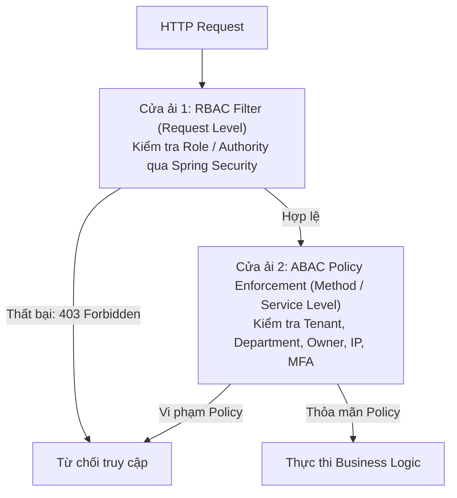

# 02. ABAC Policy: Attribute-Based Access Control

## 1. Phân loại các nhóm thuộc tính trong ABAC

* **Subject Attributes (Chủ thể thao tác):** `user.id`, `user.roles`, `user.tenantId`, `user.departmentId`, `user.assignedBranch`.
* **Resource Attributes (Tài nguyên bị tác động):** `employee.id`, `employee.tenantId`, `employee.departmentId`, `employee.status` (ACTIVE / TERMINATED), `salary.grade`.
* **Environment Attributes (Ngữ cảnh môi trường):** `env.currentTime` (giờ hành chính 08:00–18:00), `env.clientIp` (IP dải mạng nội bộ hoặc VPN công ty), `env.mfaVerified` (đã xác thực 2 bước).

---

## 2. Bảng ma trận phân quyền: RBAC vs ABAC cho 5 nghiệp vụ chính

| Action | Điều kiện RBAC (Cửa ải thô) | Điều kiện ABAC (Cửa ải tinh & Ngữ cảnh) |
| :--- | :--- | :--- |
| **Xem salary** | User có authority `salary:read` (hoặc role `HR_SPECIALIST`, `HR_MANAGER`). | • `user.tenantId == employee.tenantId` • `user.departmentId == employee.departmentId` (trừ khi là HR Manager phụ trách toàn công ty). • Không được xem lương của chính mình (chống self-review). |
| **Sửa salary** | User có authority `salary:update` (role `HR_MANAGER`). | • `user.tenantId == employee.tenantId` • `employee.status != 'TERMINATED'` (không sửa lương nhân viên đã nghỉ việc). • `env.clientIp IN (office_ip_ranges)` (chỉ cho phép sửa từ mạng công ty). |
| **Chạy payroll** | User có role `ROLE_PAYROLL_ADMIN`. | • `user.tenantId == payrollRun.tenantId` • `env.currentTime` trong khoảng ngày 25 đến 30 hàng tháng. • `env.mfaVerified == true` (bắt buộc hoàn thành xác thực 2 lớp trước khi chốt kỳ lương). |
| **Xem audit log** | User có role `ROLE_AUDITOR` hoặc `ROLE_SYSTEM_ADMIN`. | • `user.tenantId == auditLog.tenantId` • Chỉ cho phép truy vấn dữ liệu trong phạm vi kỳ kiểm toán được phân công (`auditLog.timestamp BETWEEN auditScope.start AND auditScope.end`). |
| **Employee xem profile** | User có role `ROLE_EMPLOYEE`. | • `user.id == employee.userId` (Chỉ được xem duy nhất hồ sơ cá nhân của chính mình). • `user.tenantId == employee.tenantId`. |

---

## 3. Kiến trúc tích hợp RBAC + ABAC (Defense-in-Depth)

### Nguyên tắc triển khai:
1. **Không hard-code ABAC trong Controller:** Controller chỉ nhận request và dispatch. Toàn bộ logic ABAC được đóng gói vào các Spring Security Expression Beans (ví dụ `@payrollPolicy.canExecute(...)`) hoặc tầng Policy Decision Point (PDP).
2. **Khai thác tối đa SpEL:** Sử dụng `@PreAuthorize` để đối soát thuộc tính trước khi hàm chạy, tránh rò rỉ dữ liệu hoặc cập nhật sai thẩm quyền.
