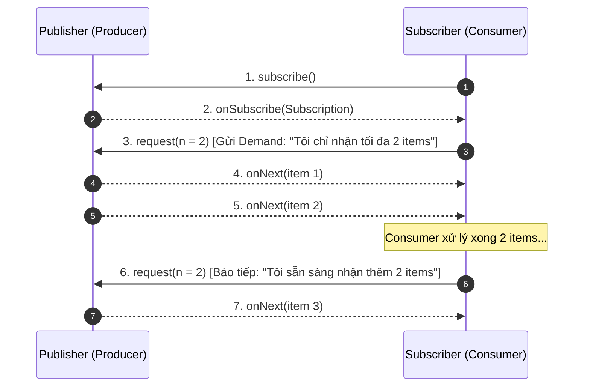

# 04. Reactive Fundamentals & Backpressure

## 1. Bản chất `Mono<T>` và `Flux<T>` trong Project Reactor

* **`Mono<T>`:** Đại diện cho một luồng dữ liệu bất đồng bộ phát ra **0 hoặc 1 giá trị**, sau đó hoàn thành (`onComplete`) hoặc báo lỗi (`onError`). Thường dùng cho các tác vụ trả về 1 bản ghi duy nhất (ví dụ: tìm nhân viên theo ID, gọi 1 API HTTP).
* **`Flux<T>`:** Đại diện cho một luồng dữ liệu bất đồng bộ phát ra **từ 0 đến N giá trị** (có thể là vô tận). 
  > **Lưu ý cốt lõi:** `Flux` là cơ chế **Streaming từng phần tử**, hoàn toàn không phải là việc load toàn bộ N phần tử vào RAM rồi mới xử lý như `List<T>`. Bộ nhớ chỉ tiêu tốn cho số lượng phần tử mà subscriber đang yêu cầu (demand).

---

## 2. Sơ đồ cơ chế Reactive Streams & Backpressure Flow

---

## 3. Phân tích kịch bản: Producer 50,000 events/s vs Consumer 5,000 events/s

### Kịch bản thực tế:
* **Payroll Event Service** xuất xưởng `50,000` sự kiện thay đổi nhân viên mỗi giây.
* **Audit Consumer** ghi xuống DB chỉ chịu tải được `5,000` sự kiện mỗi giây (chậm hơn 10 lần).

### Rủi ro nếu KHÔNG có cơ chế Backpressure / Buffering:
1. **Tràn bộ nhớ đệm (OutOfMemoryError):** Dữ liệu dồn ứ không kịp xử lý sẽ bị giữ trong internal buffer trên RAM của JVM. Với tốc độ chênh lệch 45,000 events/s, bộ nhớ 8GB sẽ cạn kiệt trong vòng vài phút.
2. **Kéo dài Latency (Bufferbloat):** Các sự kiện mới phát sinh bị xếp hàng chờ hàng giờ đồng hồ, dữ liệu kiểm toán bị trễ trầm trọng.
3. **Cascading Failure:** JVM của consumer rơi vào tình trạng Full GC liên tục (Stop-The-World), dẫn đến timeout và kéo sập toàn bộ cụm dịch vụ liên quan.

---

## 4. Chiến lược xử lý khi Consumer chậm hơn Producer

| Chiến lược | Toán tử trong Reactor | Khi nào nên áp dụng? | Đánh giá rủi ro |
| :--- | :--- | :--- | :--- |
| **Durable Queue (Khuyến nghị)** | Sử dụng Message Broker (Kafka / RabbitMQ) | Dữ liệu nghiệp vụ quan trọng, yêu cầu bảo toàn 100% dữ liệu. Broker lưu trữ đệm trên ổ cứng để consumer pull dần theo năng lực. | Chi phí hạ tầng và vận hành cluster broker. |
| **Bounded Buffer** | `onBackpressureBuffer(maxSize, strategy)` | Lưu tạm trong RAM với dung lượng giới hạn (ví dụ tối đa 10,000 items) để hấp thụ các đợt tải tăng đột biến ngắn hạn (Traffic Spikes). | Nếu quá tải kéo dài vượt `maxSize`, bắt buộc phải có chính sách drop hoặc fail-fast. |
| **Drop** | `onBackpressureDrop()` | Chỉ áp dụng cho các dữ liệu thứ cấp, không ảnh hưởng nghiệp vụ cốt lõi: Tọa độ GPS tài xế, metric telemetry, CPU log, thông báo realtime không quan trọng. | Mất mát dữ liệu vĩnh viễn. |
| **Latest** | `onBackpressureLatest()` | Người dùng chỉ quan tâm đến trạng thái mới nhất: Tỷ giá chứng khoán, giá vàng, nhiệt độ phòng realtime. | Bỏ qua các giá trị trung gian. |

> **DỮ LIỆU TUYỆT ĐỐI CẤM DROP:** Dữ liệu biến động số dư, thay đổi lương (`SalaryChange`), giao dịch chuyển tiền (`PayrollPayment`), và log kiểm toán trách nhiệm (`AuditTrail`). Toàn bộ nhóm này bắt buộc phải đi qua **Durable Broker (Kafka/RabbitMQ)** để đảm bảo At-Least-Once Delivery.
