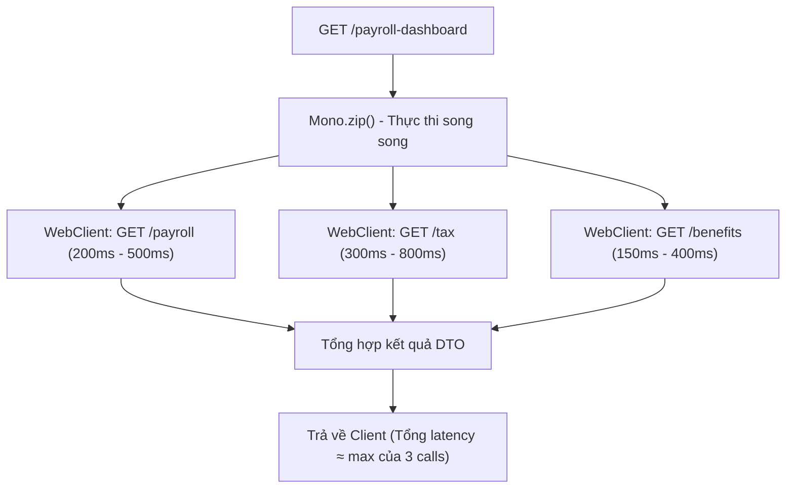

# 05. WebFlux Design: Spring MVC vs WebFlux & Remote Calls

## 1. Phân tích và Lựa chọn Công nghệ cho từng API

### API A: `GET /employees/{id}`
* **Lựa chọn:** **Spring MVC** (Servlet model truyền thống).
* **Lý do lựa chọn:**
  * Thao tác chính là truy vấn database cục bộ thông qua JPA/Hibernate (đã có Cache mức 1 hoặc Redis Cache).
  * Mô hình Blocking I/O của JPA/JDBC tương thích tự nhiên với Spring MVC thread-per-request.
  * Traffic ở mức vừa phải, việc duy trì Spring MVC mang lại code base đơn giản, dễ đọc, dễ viết Unit Test và dễ debug stack trace khi có lỗi.
* **Điểm Blocking:** Driver JDBC và EntityManager của Hibernate là Blocking I/O. Nếu ép dùng WebFlux ở đây mà không đổi driver DB thì không mang lại bất kỳ lợi ích nào mà còn làm tăng độ phức tạp.

---

### API B: `GET /payroll-dashboard` (BFF Pattern / API Gateway)
* **Lựa chọn:** **Spring WebFlux (với `WebClient`)** hoặc **Spring MVC kết hợp Virtual Threads / CompletableFuture**.
* **Lý do lựa chọn nếu đi theo Reactive Stack:**
  * Đây là API dạng tổng hợp (Aggregation API), không thao tác trực tiếp với DB nội bộ mà gọi sang 3 downstream microservices: Payroll Service, Tax Service, Benefits Service.
  * Mỗi downstream call mất từ 200ms đến 800ms. Nếu dùng Spring MVC truyền thống với blocking `RestTemplate`, 1 request sẽ chiếm dụng 1 worker thread trong suốt 800ms $\rightarrow$ Khi có 500 request đồng thời, toàn bộ 200 thread của Tomcat sẽ cạn kiệt (Thread Pool Starvation).
  * WebFlux sử dụng mô hình Event Loop Non-blocking. Chỉ cần vài threads của Netty là có thể duy trì hàng chục ngàn kết nối I/O chờ phản hồi từ downstream mà không tốn tài nguyên CPU hay Thread RAM.

---

## 2. Thiết kế luồng xử lý song song với Reactive `WebClient`



### Triển khai Code mẫu với Timeout & Fallback:
```java
public Mono<DashboardResponse> getDashboard(String tenantId) {
    Mono<PayrollDTO> payrollMono = webClient.get()
        .uri("/payroll/" + tenantId)
        .retrieve()
        .bodyToMono(PayrollDTO.class)
        .timeout(Duration.ofMillis(1000))
        .onErrorReturn(PayrollDTO.empty());

    Mono<TaxDTO> taxMono = webClient.get()
        .uri("/tax/" + tenantId)
        .retrieve()
        .bodyToMono(TaxDTO.class)
        .timeout(Duration.ofMillis(1000))
        .onErrorResume(e -> fallbackTaxService(tenantId));

    Mono<BenefitsDTO> benefitsMono = webClient.get()
        .uri("/benefits/" + tenantId)
        .retrieve()
        .bodyToMono(BenefitsDTO.class)
        .timeout(Duration.ofMillis(800))
        .onErrorReturn(BenefitsDTO.empty());

    return Mono.zip(payrollMono, taxMono, benefitsMono)
        .map(tuple -> new DashboardResponse(tuple.getT1(), tuple.getT2(), tuple.getT3()));
}
```

---

## 3. Các yêu cầu bắt buộc khi triển khai WebFlux

1. **Điều kiện Non-blocking toàn chuỗi:** Mọi thư viện liên quan (HTTP Client, Redis driver, Message Broker client) bắt buộc phải là Non-blocking (dùng `WebClient`, Reactor Netty, Lettuce).
   > **Tử huyệt:** Tuyệt đối không gọi các method blocking như `block()`, `Thread.sleep()`, hoặc query JPA bên trong Event Loop của WebFlux. Việc này sẽ làm "đông cứng" toàn bộ server vì Netty chỉ có số lượng thread bằng số CPU Core!
2. **Chiến lược Timeout & Concurrency Limit:**
   * Mọi remote call bắt buộc phải có `timeout(...)`.
   * Sử dụng Circuit Breaker (Resilience4j Reactive) để ngắt mạch khi một downstream service (như Tax Service) bị treo, tránh gây hiệu ứng sụp đổ dây chuyền (Cascading Failure).
3. **Làm rõ ngộ nhận "WebFlux nhanh hơn":**
   * WebFlux **KHÔNG làm code chạy nhanh hơn** đối với một request đơn lẻ (thậm chí có thể chậm hơn vài mili-giây do overhead của việc tạo Publisher/Subscriber pipeline).
   * Điểm mạnh thực sự của WebFlux là **khả năng chịu tải đồng thời (Elasticity & High Concurrency)** với lượng tài nguyên phần cứng (Memory/Thread) ít hơn nhiều so với mô hình thread-per-request.
