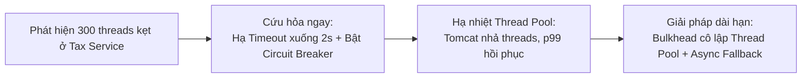

# 06. Profiling Runbook: Điều tra và Xử lý Sự cố Latency

## 1. Phân tích hiện tượng sự cố (Symptom Analysis)

* **Hiện tượng:**
  * Payroll Dashboard có p99 vọt lên `8 giây`.
  * Application CPU thấp (`35%`).
  * Heap memory: Rất ổn định, không có dấu hiệu phình to hay dồn dập GC.
  * Database CPU: `40%` (không bị nghẽn DB).
  * Thread count: Vọt lên `450 threads`.
  * **Chỉ dấu then chốt:** Có tới `300 threads` đang ở trạng thái `WAITING` tại lời gọi HTTP Client sang Tax Service.

---

## 2. Giả thuyết nguyên nhân gốc rễ (Root-Cause Hypothesis)

* **Bản chất vấn đề:** Đây là sự cố **I/O-Bound & Thread Pool Starvation**, hoàn toàn không phải lỗi CPU-bound hay Memory-bound.
* **Nguyên nhân chi tiết:**
  1. Tax Service bên thứ ba bị chậm hoặc treo phản hồi (độ trễ phản hồi lên tới vài giây).
  2. HTTP Client phía ứng dụng (như `RestTemplate` hoặc Apache HttpClient) cấu hình `readTimeout` quá lớn (hoặc mặc định không giới hạn).
  3. Kết quả là 300 luồng worker của Tomcat bị "giam lỏng" để chờ byte dữ liệu từ Tax Service, làm cạn kiệt thread pool khả dụng, khiến các request dashboard khác đến sau bị tắc nghẽn xếp hàng (Queue latency tăng vọt lên 8s).

---

## 3. Lựa chọn Artifact chẩn đoán & Lý do loại trừ Heap Dump

| Artifact | Mức độ ưu tiên | Mục đích kiểm tra |
| :--- | :---: | :--- |
| **Thread Dump** (3 snapshots cách nhau 5s) | **Ưu tiên #1** | Xác nhận vị trí dòng code mà 300 threads đang bị kẹt (`java.net.SocketInputStream.socketRead0()`), kiểm tra tên thread pool và stack trace chi tiết. |
| **Distributed Tracing (Jaeger / Zipkin)** | **Ưu tiên #2** | Xem Timeline Waterfall của request để chứng minh 90% thời gian 8s nằm ở span gọi sang `tax-service`. |
| **Java Flight Recorder (JFR)** | **Ưu tiên #3** | Bật JFR 2 phút để đo `Socket Read Wait` event và mức tiêu thụ tài nguyên mà không làm chậm server. |
| **Heap Dump** | **CẤM DÙNG (Không cần thiết)** | **Lý do:** Heap đang rất ổn định, không có dấu hiệu Memory Leak hay Full GC. Việc chụp Heap Dump 8GB–16GB sẽ gây Stop-The-World đóng băng toàn bộ server trong 20–40 giây, làm sự cố latency trở nên tồi tệ hơn gấp 10 lần! |

---

## 4. Runbook cứu hỏa (Immediate Mitigation) & Giải pháp bền vững (Long-Term Fix)

### A. Cứu hỏa tức thời (Immediate Mitigation):
1. **Ép cấu hình Timeout:** Cập nhật nóng qua Spring Cloud Config / Consul:
   * `connectTimeout`: `1000ms`.
   * `readTimeout`: `2000ms` (thay vì 10s–30s).
2. **Kích hoạt Circuit Breaker (Resilience4j):**
   * Nếu Tax Service lỗi/timeout > 50% trong 1 phút $\rightarrow$ Mở mạch (OPEN), lập tức trả về dữ liệu ước tính tạm thời hoặc thông báo *"Thông tin thuế đang được cập nhật sau"* để trả response ngay trong 50ms, giải phóng 300 threads ngay lập tức.

### B. Giải pháp gốc rễ dài hạn (Long-term Fix):
1. **Áp dụng Bulkhead Pattern:** Tách riêng Thread Pool cho Tax Client (tối đa chỉ cấp 20 threads). Dù Tax Service có sập thì tối đa chỉ 20 threads bị kẹt, 430 threads còn lại vẫn phục vụ các tính năng khác bình thường.
2. **Chuyển đổi sang Non-blocking WebClient hoặc Virtual Threads (Java 21):** Loại bỏ hoàn toàn sự phụ thuộc vào số lượng OS Platform Threads khi chờ đợi I/O mạng.
