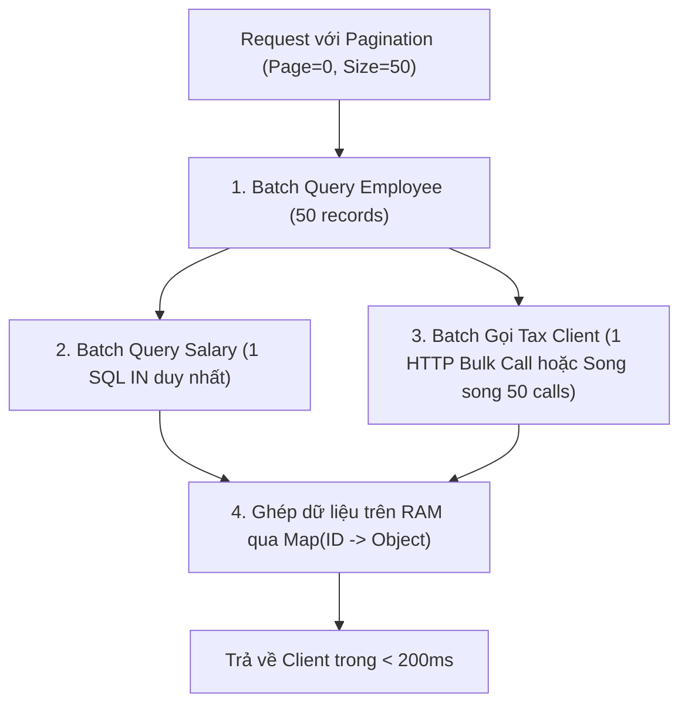

# 07. Performance Anti-Patterns trong Spring & Hibernate

## 1. Đoạn mã có vấn đề (Code Smells & Anti-Patterns)

```java
public List<EmployeeDashboardResponse> getDashboard(String tenantId) {
    List<Employee> employees = employeeRepository.findByTenantId(tenantId);

    return employees.stream()
        .map(employee -> {
            Salary salary = salaryRepository.findLatestByEmployeeId(employee.getId());
            TaxProfile tax = taxClient.getTaxProfile(employee.getId());
            return new EmployeeDashboardResponse(employee, salary, tax);
        })
        .toList();
}
```

---

## 2. Bóc tách chi tiết các Anti-Patterns cốt lõi

### A. Lỗi N+1 Database Queries (Cực kỳ nghiêm trọng)
* Dòng 2 thực thi 1 query: `SELECT * FROM employee WHERE tenant_id = ?`. Giả sử trả về $N$ nhân viên.
* Trong vòng lặp `map`, dòng 6 lại thực thi: `SELECT * FROM salary WHERE employee_id = ?` lặp lại đúng $N$ lần.
* **Tổng số câu lệnh SQL:** $1 + N$ queries.

### B. Lỗi N+1 Remote HTTP Calls (Thảm họa hiệu năng)
* Dòng 7: `taxClient.getTaxProfile(employee.getId())` thực hiện một cuộc gọi HTTP tuần tự qua mạng cho từng nhân viên một.
* **Độ trễ tích lũy:** Nếu gọi DB mất 2ms thì gọi HTTP mạng mất từ 50ms đến 200ms mỗi lần. Với $N$ lần gọi tuần tự, ứng dụng sẽ bị "treo" chờ mạng.

### C. Rủi ro khổng lồ khi Tenant có 10,000 nhân viên
* **Số lượng kết nối:** 10,001 truy vấn DB + 10,000 cuộc gọi HTTP mạng!
* **Thời gian phản hồi (Latency):**
  $$\text{Thời gian} \approx 10,000 \times 100\text{ms} = 1,000,000\text{ms} = 1,000\text{ giây} \approx 16.6\text{ phút!}$$
* **Hậu quả thực tế:**
  1. HTTP Request bị Gateway/Load Balancer ngắt timeout ngay sau 30–60 giây (lỗi `504 Gateway Timeout`).
  2. Bị Tax Service coi là hành vi tấn công từ chối dịch vụ (DDoS) và kích hoạt IP Rate Limit chặn toàn bộ hệ thống.
  3. Tràn bộ nhớ Heap (OOM) khi gom 10,000 DTO lớn vào RAM cùng một lúc.

### D. Điểm Blocking nếu chuyển sang Spring WebFlux
* Nếu chỉ đơn giản bọc đoạn code này vào `Flux.fromIterable(...)`, hàm `salaryRepository.findLatestByEmployeeId()` (JPA/JDBC) và `taxClient` (nếu dùng `RestTemplate`) **vẫn là Blocking I/O**.
* Việc chạy Blocking I/O bên trong luồng Event Loop của WebFlux sẽ làm tê liệt toàn bộ worker threads của Netty, khiến toàn bộ server không thể tiếp nhận thêm bất kỳ request nào khác!

---

## 3. Chiến lược Tối ưu hóa Toàn diện (Refactoring Strategy)



### Triển khai Code đã tái cấu trúc (Refactored):

```java
public Page<EmployeeDashboardResponse> getDashboard(String tenantId, Pageable pageable) {
    // 1. Phân trang bắt buộc (Tránh load 10,000 records cùng lúc)
    Page<Employee> employeePage = employeeRepository.findByTenantId(tenantId, pageable);
    List<Employee> employees = employeePage.getContent();
    if (employees.isEmpty()) {
        return Page.empty(pageable);
    }

    List<Long> employeeIds = employees.stream().map(Employee::getId).toList();

    // 2. Triệt tiêu N+1 DB: Gom thành 1 query duy nhất với IN clause
    // SELECT * FROM salary WHERE employee_id IN (...) AND is_latest = true
    Map<Long, Salary> salaryMap = salaryRepository.findLatestByEmployeeIds(employeeIds)
        .stream().collect(Collectors.toMap(Salary::getEmployeeId, Function.identity()));

    // 3. Triệt tiêu N+1 HTTP: Dùng API Bulk Fetch của Tax Service
    // POST /tax/profiles/bulk-fetch với payload = [id1, id2, ...]
    Map<Long, TaxProfile> taxMap = taxClient.getTaxProfilesBatch(employeeIds);

    // 4. Ghép dữ liệu trong O(N) nhờ tra cứu O(1) qua HashMap
    List<EmployeeDashboardResponse> responses = employees.stream()
        .map(emp -> new EmployeeDashboardResponse(
            emp, 
            salaryMap.get(emp.getId()), 
            taxMap.get(emp.getId())
        ))
        .toList();

    return new PageImpl<>(responses, pageable, employeePage.getTotalElements());
}
```

---

## 4. Các Metrics cần giám sát sau khi tối ưu

1. **SQL Statement Count per Request:** Kiểm tra qua datasource-proxy, cam kết đúng 2 câu lệnh SQL cho mỗi request dashboard (1 query employee có `LIMIT/OFFSET`, 1 query salary `IN (...)`).
2. **P95 / P99 Latency:** Thời gian phản hồi phải giảm từ > 10s xuống ổn định dưới **200ms**.
3. **Database Connection Hold Time:** Thời gian giữ kết nối DB giảm từ hàng chục giây xuống dưới 15ms.
4. **Throughput (RPS):** Khả năng gánh tải của API tăng lên ít nhất 20–50 lần mà không làm tăng tiêu hao RAM/CPU.
